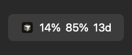
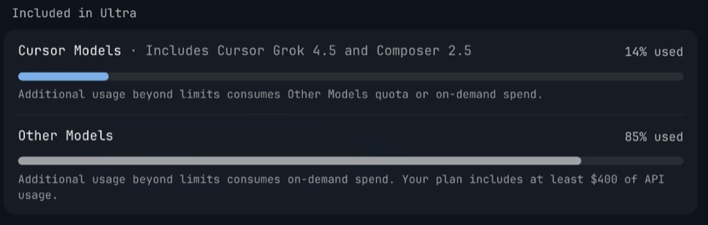

<p align="center">
  
</p>

<h1 align="center">CursorUsage</h1>

<p align="center">
  Cursor plan usage in your macOS menu bar
</p>

<p align="center">
  <a href="https://github.com/rlimberger/CursorUsage/blob/main/LICENSE"></a>
  <a href="https://developer.apple.com/macos/"></a>
  <a href="https://www.swift.org"></a>
  <a href="https://cursor.com"></a>
</p>

<p align="center">
  
</p>

<p align="center">
  
</p>

See **Cursor Models** %, **Other Models** %, and days until reset without opening Cursor Settings. Same two usage pools as the in-app Usage panel.

**Omarchy / Linux:** Waybar port is staged in [`omarchy/`](omarchy/) and will live at [rlimberger/cursor-usage-omarchy](https://github.com/rlimberger/cursor-usage-omarchy) once the Cursor GitHub App can push there (see [`omarchy/SPLIT_REPO.md`](omarchy/SPLIT_REPO.md)).

## Quick start

```bash
git clone https://github.com/rlimberger/CursorUsage.git
cd CursorUsage
./scripts/build-app.sh install
```

Builds a release app, installs to `~/Applications/CursorUsage.app`, enables **Open at Login**, and launches.

> Requires [Xcode](https://developer.apple.com/xcode/) or Xcode beta (macOS 14+). Bare Command Line Tools are not enough.

## Features

| | |
| --- | --- |
| **Live menu bar** | `icon → Cursor % → API % → days` at system menu-bar font size |
| **Popover** | Progress bars, plan name, refresh, dashboard link |
| **No extra login** | Reuses the session from the Cursor IDE |
| **Open at Login** | Registered on first launch (toggle in the popover) |
| **Cursor-aware** | Item shows only while Cursor is running |

## Usage

1. Sign in to Cursor as usual.
2. Keep CursorUsage running (it starts at login by default).
3. When Cursor is open, the menu bar shows usage; click for details.

```
[◆]  14%  85%  13d
      │    │    └─ days until billing cycle resets
      │    └─ Other Models (API / named models)
      └─ Cursor Models (e.g. Grok / Composer)
```

**Quit:** popover → Quit, or `killall CursorUsage`.

## How it works

1. Reads your access token (read-only) from  
   `~/Library/Application Support/Cursor/User/globalStorage/state.vscdb`
2. Calls Cursor’s `GetCurrentPeriodUsage` API with that token
3. Maps `autoPercentUsed` → Cursor Models, `apiPercentUsed` → Other Models
4. Refreshes every 5 minutes (or on **Refresh**)

Uses an **undocumented** Cursor API. It may change without notice. Not affiliated with Anysphere / Cursor.

## Build options

```bash
# Build only → dist/CursorUsage.app
./scripts/build-app.sh

# Build + install + launch
./scripts/build-app.sh install
```

The script prefers `/Applications/Xcode-beta.app`, then `/Applications/Xcode.app`:

```bash
export DEVELOPER_DIR=/Applications/Xcode-beta.app/Contents/Developer
```

## Privacy

- Token is only sent to Cursor’s own API as a Bearer credential
- No third-party analytics or servers
- Local database access is read-only

## FAQ

**Nothing appears in the menu bar**  
CursorUsage only inserts the item while **Cursor.app** is running. Open Cursor, or check System Settings → Menu Bar if macOS is hiding the item.

**Open at Login didn’t stick**  
Enable **CursorUsage** under System Settings → General → Login Items (SMAppService sometimes needs approval).

**Numbers look wrong / failed to load**  
Sign out and back into Cursor, then click **Refresh**. The local session token may have expired.

**Is this official?**  
No. Community tool that scrapes the same usage data the IDE already uses.

## Contributing

Issues and PRs are welcome for bugs and small improvements. Please open an issue before large design changes.

## License

[MIT](LICENSE) © Rene Limberger
